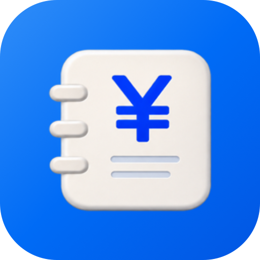

# 桌面图标调整

- 资源：`app/src/main/res/drawable-nodpi/wmm_launcher_foreground.png`。
- 使用内置 image_gen 编辑已有瓷白账本和 ¥ 前景，保留蓝色渐变背景，移除前景右侧多余横线。
- 生成后使用 CoreGraphics 按透明边界裁切并归一化到 432 × 432 画布中央的 180 × 180 正方形，四边留白各 126px。原前景可见高度约 214px，本次缩小约 16%。没有改动运行时自适应图标结构。
- 下图为圆角方形遮罩示意，手机桌面会按系统形状裁切。



## 生成提示词

```text
Use case: precise-object-edit. Edit target: attached existing Android app launcher foreground. Preserve the same polished ivory/porcelain 3D ledger notebook, three white binding loops on the left, vivid royal blue ¥ currency symbol, and two subtle horizontal grooves below it. This is a restrained production correction of the existing asset, not a redesign. Remove the stray thin horizontal line extending from the notebook to the right edge. Keep a genuinely transparent background, with no blue tile, no frame, no ground plane or cast floor shadow. Output one square 1024x1024 transparent PNG. Center the complete notebook including binding loops at (512,512). Make its outer visible silhouette approximately square, and occupy only the central 42% of canvas width and 42% of canvas height, i.e. x=297..727 and y=297..727, leaving equal generous transparent margins on all four sides. Reduce the current overlarge motif slightly; the whole object should remain recognizable at phone-launcher size. All bindings, bevels and soft edge shading must remain within that centered square. Keep the exact ¥ glyph, ivory material and blue palette. No additional writing, no watermark, no detached pixels or horizontal baseline.
```
